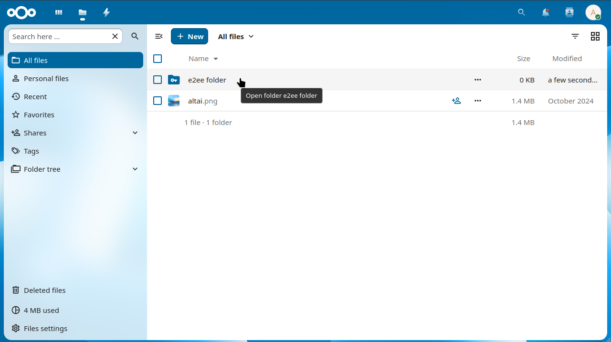

<!--
  - SPDX-FileCopyrightText: 2017 Nextcloud GmbH and Nextcloud contributors
  - SPDX-License-Identifier: AGPL-3.0-or-later
-->
# End-to-End Encryption App

[](https://api.reuse.software/info/github.com/nextcloud/end_to_end_encryption)

This app provides all the necessary APIs to implement End-to-End encryption
on the client side and in the browser.



## Table of contents

- [Documentation](#documentation)
  - [User documentation](#user-documentation)
  - [Administrator documentation](#administrator-documentation)
  - [Client API](#client-api)
  - [Specification (RFC)](#specification-rfc)
- [Development](#development)
  - [Building the app](#building-the-app)
  - [Contributing](#contributing)
    - [Contribution guidelines](#contribution-guidelines)
  - [Stable branches](#stable-branches)

## Documentation

### User documentation

How to set up end-to-end encryption in your clients, encrypt folders, use the personal settings and troubleshoot common issues is described in the [user documentation](doc/user.md).

### Administrator documentation

How to install and configure the app, handle the deprecation of legacy v1 metadata and use the OCC commands is described in the [administrator documentation](doc/admin.md).
Security relevant actions recorded in the audit log are listed in the [audit log actions documentation](doc/audit-log-actions.md).

### Client API

Here you can find the [API documentation](doc/api.md). Also some [typical client operations and how to use the API to perform them](doc/api-usage.md) are documented too.

### Specification (RFC)

The end-to-end encryption implemented by the Nextcloud sync and mobile clients, as well as the functionality provided by this app to facilitate it, is based on the approach documented in the [RFC repository](https://github.com/nextcloud/end_to_end_encryption_rfc/).

## Development
There are many ways to contribute, of which development is only one! Find out [how to get involved](https://nextcloud.com/contribute/), including as a translator, designer, tester, helping others, and much more! 😍

Specific to this app we summarize the basic steps how to get involved below.

### Building the app
This is is built using PHP on the backend side as well as Typescript and Vue.js on the frontend side.
For building the frontend you need to install the currently active Node.js version (see `engines` in the `package.json`).
To built the app from a fresh checkout of the repository run:

1. `npm ci` to install the frontend dependencies
2. `npm run build` to build the frontend

When developing there are some more commands which might be useful for you:

- `npm run dev` to build the frontend in development mode enabling support for the Vue devtools.
- `npm run watch` similar to `dev` but rebuilds as soon as there are code changes in the sources.
- `npm run lint` to check for linting issues (e.g. code style). Always check this before contributing code.
- `npm run stylelint` similar as `lint` but for the `<style>` section of our Vue files.
- `npm run test` to run our frontend unit tests.

### Contributing
#### Contribution guidelines
All contributions to this repository are considered to be licensed under the AGPLv3 or any later version.

Nextcloud doesn't require a CLA (Contributor License Agreement).
The copyright belongs to all the individual contributors.
Therefore we recommend that every contributor adds the following line to the [AUTHORS](AUTHORS.md) file if they made substantial changes to the code:

```
- <your name> <your email address>
```

**We can only accept contributions from authors that agree on the [Developer Certificate of Origin](https://developercertificate.org/)!**
For this please make sure to sign-off your commits if you want to contribute code (`git commit -s`).

Please read the [Code of Conduct](https://nextcloud.com/community/code-of-conduct/). This document offers some guidance to ensure Nextcloud participants can cooperate effectively in a positive and inspiring atmosphere and to explain how together we can strengthen and support each other.

### Stable branches

Before Nextcloud 33 each we published one app version per Nextcloud version
and maintained a branch per Nextcloud versions like `stable32` for Nextcloud 32.

Since Nextcloud 33 we switched to a versions based branch process,
where we will keep support of multiple Nextcloud versions within a single app version.
So the new naming schema is e.g. `stable-2` for the v2.x series of this app.
