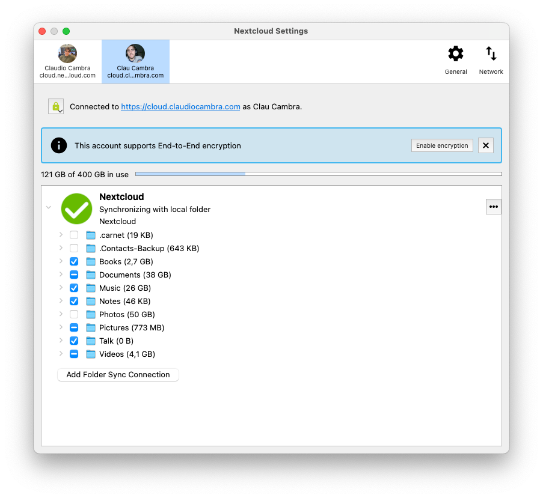
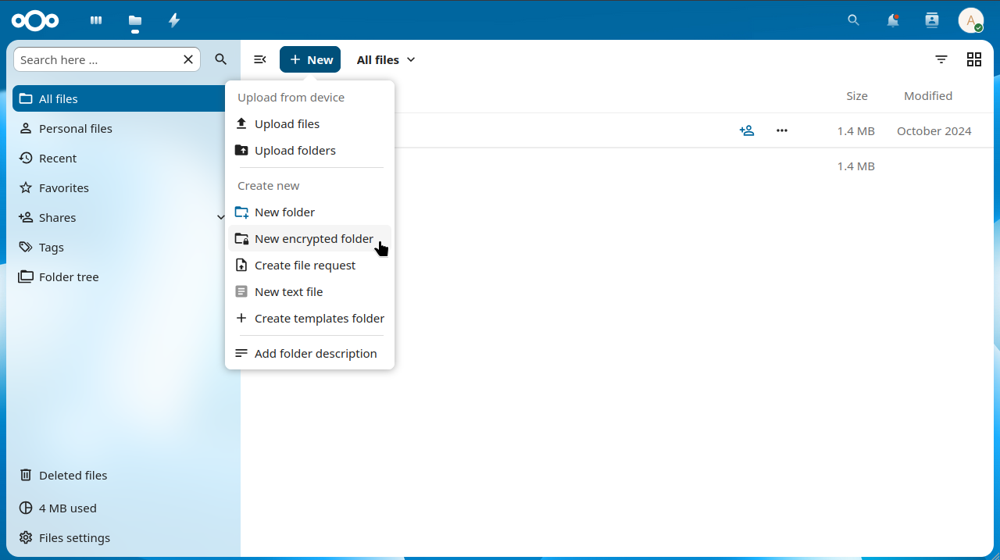

<!--
  - SPDX-FileCopyrightText: 2026 Nextcloud GmbH and Nextcloud contributors
  - SPDX-License-Identifier: AGPL-3.0-or-later
-->
# End-to-end encryption: User documentation

This document describes how to set up and use end-to-end encryption (E2EE) as a user.
For installing and maintaining the app on the server see the [administrator documentation](admin.md).

## Table of contents

- [Setting up end-to-end encryption](#setting-up-end-to-end-encryption)
- [Encrypting a folder](#encrypting-a-folder)
- [Personal settings](#personal-settings)
  - [E2EE navigation in the browser](#e2ee-navigation-in-the-browser)
  - [Debugging tools](#debugging-tools)
  - [Resetting end-to-end encryption](#resetting-end-to-end-encryption)
- [Troubleshooting](#troubleshooting)
  - [General](#general)
  - [Data not being encrypted](#data-not-being-encrypted)
  - [Recovery](#recovery)

## Setting up end-to-end encryption

1. Trigger the "Setup end-to-end encryption" under settings within your favorite client app (all official clients support E2EE).
2. *Carefully* note your mnemonic (encryption passphrase) generated by your first client. The mnemonic is needed to: recover access to your data (i.e. if your device is lost or you need to reinstall the app) as well as to setup additional clients.

> [!CAUTION]
> The mnemonic is *not* recoverable by a server administrator. If you lose your mnemonic you *will* lose access to your encrypted data.

Nextcloud Desktop client, once the server app is enabled:

Nextcloud Android app, awaiting the initial setup:

## Encrypting a folder

Encryption must be actively enabled for folders. This can be done in any of the officially supported client apps (desktop, Android, iOS).

In the desktop client, the option to encrypt can be found in the context menu (right click) of subfolders of a folder synchronization. Please note that it's neither possible to encrypt the root folder of a folder synchronization, nor to encrypt a subfolder with existing content.

With [E2EE navigation in the browser](#e2ee-navigation-in-the-browser) enabled, encrypted folders can also be created in the Nextcloud web interface using *New -> New encrypted folder*:

## Personal settings

The end-to-end encryption settings are found under *Personal settings -> Security*:

If your administrator limited end-to-end encryption to some groups and you are not a member of them, this section is not available.

### E2EE navigation in the browser

By default, end-to-end encrypted folders cannot be opened in the web interface.
Using *Enable E2EE navigation in browser* you can opt in to browse, read (using the viewer app) and download end-to-end encrypted files in the browser.
This requires a browser supporting the Web Crypto API and an HTTPS connection.

> [!WARNING]
> Enabling E2EE in the browser can weaken security:
> the server could serve malicious source code to extract the secret that protects your files.

### Debugging tools

If allowed by your administrator, *Enable debugging tools for encrypted folders* adds a "Debug encryption" action to encrypted folders in the web interface.
It shows the metadata of the folder, which helps to investigate issues with encrypted folders.
The debugging tools require the [E2EE navigation in the browser](#e2ee-navigation-in-the-browser).

### Resetting end-to-end encryption

If you lost your mnemonic, you can reset your end-to-end encryption keys using *Reset end-to-end encryption*.

> [!CAUTION]
> Once your end-to-end encryption keys are reset, all files stored in your encrypted folders will be inaccessible.
> Only reset your keys if you lost your mnemonic, and check on all connected devices if you can still retrieve it first.

Any device that is still connected might cause problems after the keys are deleted, so it is better to disconnect and reconnect your devices.

## Troubleshooting

### General

- Since all encryption is handled by the clients, it is important that all client versions in-use be kept relatively aligned (in terms of release version/period) to maintain end-to-end compatibility.
- Since most operations are performed by the clients, in most cases potential bugs will need to be addressed in the clients (though sometimes in coordination with development occurring here with the server app).
- Be careful not to configure different mnemonics across your devices. They must all share the same mnemonic (created on the first device you provision E2EE on) or undefined behavior will occur.
- Keep in mind that using end-to-end encryption has trade-offs. Some functions will never be supported because they are inherently incompatible with the threat model of E2EE. In other cases, functionality may not yet be implemented in your favorite client (in this case you're encouraged to visit the Issues of your respective client and upvote the existing enhancement idea and/or submit your own where one does not already exist).
- Encrypted folders created with older clients may still use the legacy v1 metadata format, which will no longer be supported soon. Open your encrypted folders with an up-to-date desktop client to migrate them to the current format.

### Data not being encrypted

- E2EE focuses on protecting your file-based data, but not other application data (e.g. calendars).

### Recovery

There are various recovery scenarios where it may be useful to access (decrypt) your files independent of your Nextcloud installation. A separate set of tools called the [`encryption-recovery-tools`](https://github.com/nextcloud/encryption-recovery-tools) can be used for this.
